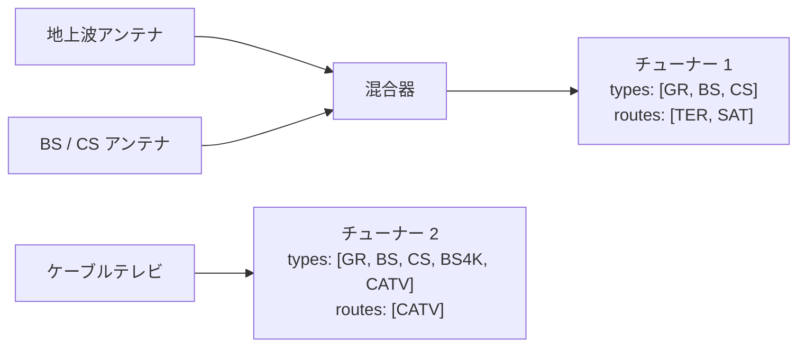
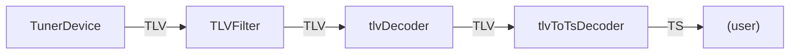
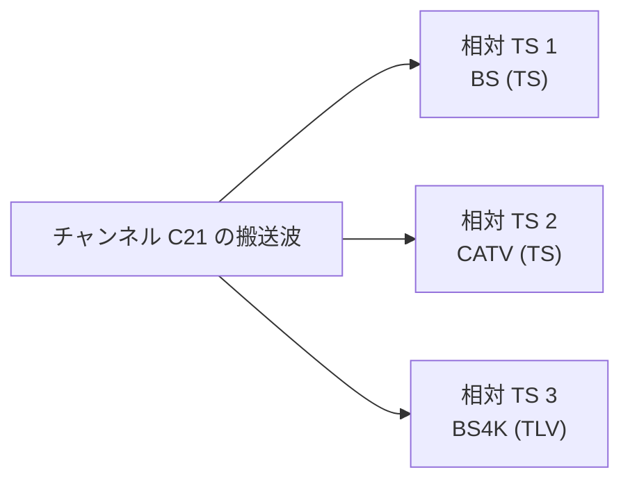
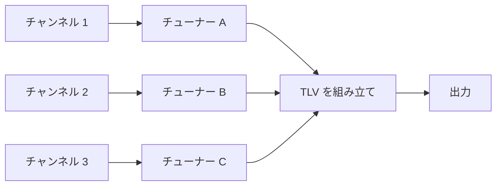
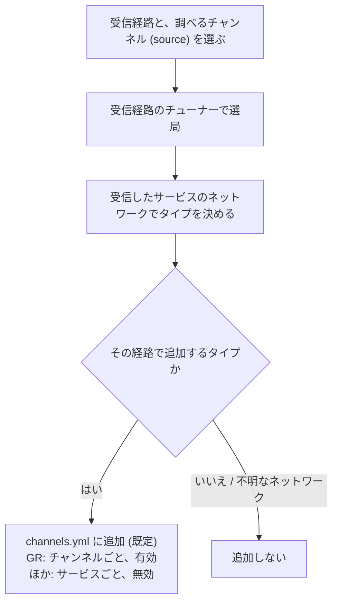

[**English**](Configuration.md) | [**日本語**](Configuration.ja.md)

# 設定

- 🗒️[server.yml](#serveryml) - サーバー設定
- 🗒️[tuners.yml](#tunersyml) - チューナー設定
- 🗒️[channels.yml](#channelsyml) - チャンネル設定

## ⚠️セキュリティ上の留意事項 (FYI)

- Mirakurun は LAN 内専用サーバーです。
- デフォルト設定でアクセス元をプライベート IP のみに制限しています。
- 任意のホスト名・ドメイン上のページからのアクセスを禁止しています。 → **DNS Rebinding / CSRF 攻撃対策**
  - `hostname`: Web UI にアクセスするためのホスト名を設定してください。
  - `allowOrigins`: 必要に応じて、許可するホスト名・ドメインを明示的に設定してください。
- 複数の手法を組み合わせて攻撃のリスクを緩和しています。
- 無暗に全てのドメインから API アクセスできるようにしたり、リバースプロキシの下に置かないでください。下記のような攻撃に対して脆弱になります。
  - 認証済みの BASIC 認証やセッション情報などを流用して攻撃する手法が存在します。
  - 最近はブラウザ自体もある程度保護していますが、過信しないでください。
  - リバースプロキシで HTTPS 化した場合、ブラウザ自体と Mirakurun の保護機能をいくつかバイパスする可能性があり、逆に危険度が増します。 → [保護されたコンテキスト](https://developer.mozilla.org/ja/docs/Web/Security/Secure_Contexts)
  - 代わりに VPN や SSH トンネル、トンネルサービスを活用してください。
    - 一部のトンネルサービスは `allowIPv4CidrRanges` の設定が必要です。第三者がアクセスできないように注意して設定してください。

> **DNS Rebinding 攻撃**: 攻撃者が管理するドメインで最初に正規サイトを返し、TTL期限後に攻撃者のサーバーを指すように変更する攻撃。これによりブラウザの同一オリジンポリシーを迂回し、ブラウザ経由で LAN 内のサーバーに不正アクセスする攻撃。

> **XSS/CSRF 攻撃**: 攻撃者が悪意のあるコードをウェブサイトに埋め込み、ブラウザ経由で LAN 内のサーバーに不正アクセスする攻撃。

- 攻撃例:
  - チューナーコマンド等を利用して任意のコードを実行
  - サーバーに不正なコードを仕込み、botnet 化
- 上記はあくまで攻撃の一例です。ブラウザやミドルウェアの脆弱性等により、日々様々な攻撃手法が考えられています。
- 近年増加傾向の Web ベースのアプリでは、ブラウザと同様の攻撃が可能な場合があります。注意しましょう。

## 🗒️server.yml

📛 Web UI 設定一部対応

### ファイルパス

- 環境変数: `SERVER_CONFIG_PATH`
- Docker ホスト (デフォルト): `/opt/mirakurun/config/server.yml`
- Linux (レガシー): `/usr/local/etc/mirakurun/server.yml`

### サーバー設定一覧

| プロパティ (🗒️server.yml) | 環境変数 (🐋Docker) | タイプ | デフォルト | 説明 |
|------------|------------------|-------|-----------|------|
| `logLevel` | `LOG_LEVEL` | Integer | `2` | ログレベル (`-1`: FATAL から `3`: DEBUG) |
| `maxLogHistory` | `MAX_LOG_HISTORY` | Integer | `1000` | ログの最大保持行数 |
| `path` | - | String, null | 🗒️`/var/run/mirakurun.sock` | Unix Socket Path **※Docker ではデフォルトパスに固定** |
| `port` | - | Integer, null | `40772` | サーバーポート **※Docker ではコンテナ側 `40772` 固定** |
| `hostname` | `HOSTNAME` | String | `localhost` | ホスト名 |
| `disableIPv6` | - | Boolean | `false` | IPv6の無効化 **※Docker では常に無効** |
| `jobMaxRunning` | `JOB_MAX_RUNNING` | Integer | 論理コア数 / 2, 最低 1, 最大 100 | 同時実行できる最大ジョブ数 |
| `jobMaxStandby` | `JOB_MAX_STANDBY` | Integer | 論理コア数 - 1, 最低 1, 最大 100 | 同時実行できる最大ジョブ準備数 |
| `maxBufferBytesBeforeReady` | `MAX_BUFFER_BYTES_BEFORE_READY` | Integer | `8388608` | 準備完了前の最大バッファサイズ (バイト)<br>**※番組開始の頭が欠ける場合は増やす** |
| `eventEndTimeout` | `EVENT_END_TIMEOUT` | Integer | `1000` | イベント終了タイムアウト (ミリ秒)<br>**※番組終了が誤判定される場合は長くする** |
| `programGCJobSchedule` | `PROGRAM_GC_JOB_SCHEDULE` | String | `45 * * * *` | 番組一覧の GC スケジュール (cron 風形式) |
| `epgGatheringJobSchedule` | `EPG_GATHERING_JOB_SCHEDULE` | String | `20,50 * * * *` | EPG 収集スケジュール (cron 風形式) |
| `epgRetrievalTime` | `EPG_RETRIEVAL_TIME` | Integer | `600000` | EPG 取得時間 (ミリ秒) |
| `logoDataInterval` | `LOGO_DATA_INTERVAL` | Integer | `604800000` | ロゴデータ更新間隔 (ミリ秒) |
| `disableEITParsing` | `DISABLE_EIT_PARSING` | Boolean | `false` | ⚠️EIT パースの無効化 |
| `disableWebUI` | `DISABLE_WEB_UI` | Boolean | `false` | ⚠️Web UI の無効化 |
| `allowIPv4CidrRanges` | `ALLOW_IPV4_CIDR_RANGES` | String[] | `["10.0.0.0/8", "127.0.0.0/8", "172.16.0.0/12", "192.168.0.0/16"]` | ⚠️許可する IPv4 CIDR ブロック |
| `allowIPv6CidrRanges` | `ALLOW_IPV6_CIDR_RANGES` | String[] | `["fc00::/7"]` | ⚠️許可する IPv6 CIDR ブロック |
| `allowOrigins` | `ALLOW_ORIGINS` | String[] | `["https://mirakurun-secure-contexts-api.pages.dev"]` | ⚠️🧪許可するオリジン (実験中) |
| `allowPNA` | `ALLOW_PNA` | Boolean | `true` | 🧪[PNA](https://github.com/WICG/private-network-access)/[LNA](https://github.com/explainers-by-googlers/local-network-access) 許可設定 (実験中) |
| `tsplayEndpoint` | `TSPLAY_ENDPOINT` | String | `https://mirakurun-secure-contexts-api.pages.dev/tsplay/` | 🧪TSPlay エンドポイント (実験中) |
| `defaultTlvStreamFormat` | `DEFAULT_TLV_STREAM_FORMAT` | String | `tlv` | `format` を付けないストリームの要求に対する、TLV (MMT) のチャンネルの出力形式 (`ts` または `tlv`)<br>`ts` を指定した場合、対象チャンネルを受信できるチューナーに `tlvToTsDecoder` が設定されていなければ HTTP 406 を返す |

## 🗒️tuners.yml

💯 Web UI 設定完全対応

### ファイルパス

- 環境変数: `TUNERS_CONFIG_PATH`
- Docker ホスト (デフォルト): `/opt/mirakurun/config/tuners.yml`
- Linux (レガシー): `/usr/local/etc/mirakurun/tuners.yml`

### 構造

```yaml
# 配列
- name: チューナー識別名 # String
  types: # (GR|BS|CS|SKY|BS4K|CATV)[] - 受信できるタイプ
    - GR
    - BS
    - CS
  routes: # (TER|SAT|SKY|CATV|FTTH)[] - 入力に届いている受信経路。省略した場合はすべて
    - TER
    - SAT
  # chardev/dvb用
  # "<template>"は`commandVars[template]`または"(空)"に置き換えられます *@4.0.0~
  # "<route>"は選局するチャンネルの経路の小文字 (ter|sat|sky|catv|ftth) に置き換えられます
  command: cmd <channel> --arg1 --arg2 <exampleArg1> <exampleArg2>... # String
  # dvb用
  dvbDevicePath: /dev/dvb/adapter/dvr/path # String
  disableDvbDirect: false # Boolean
  # リモートMirakurunとの多重化用
  remoteMirakurunHost: 192.168.x.x # String
  remoteMirakurunPort: 40772 # Integer
  remoteMirakurunDecoder: false # Boolean
  # 以下はオプション
  decoder: cmd # String
  tlvDecoder: cmd # String
  tlvToTsDecoder: cmd # String
  isDisabled: false # Boolean
```

#### types / routes

チャンネルは、`types` にチャンネルのタイプを、`routes` にチャンネルの受信経路を含むチューナーで選局します。タイプと受信経路は [タイプと受信経路](#タイプと受信経路) を参照してください。

- `routes` は、チューナーの入力に届いている経路です。省略した場合は、すべての経路を受信できるものとして扱います (従来と同じ)。
- 混合器で地上波と BS / CS のアンテナを 1 本にまとめている場合などは、複数の経路を指定します。



この例では、受信経路が `CATV` のチャンネルはチューナー 2 だけで、`TER` と `SAT` のチャンネルはチューナー 1 だけで選局します。

#### dvbv5-zap のチャンネル設定ファイル

同梱の [dvbconf-for-isdb](https://github.com/Chinachu/dvbconf-for-isdb) には、受信経路ごとのチャンネル設定ファイル `dvbv5_channels_<経路>.conf` があります。`-c` に `<route>` を書くと、選局するチャンネルの経路のファイルを使います。

```yaml
- name: adapter0
  types:
    - GR
  routes:
    - TER
  command: dvbv5-zap -a 0 -c ./config/dvbconf-for-isdb/conf/dvbv5_channels_<route>.conf -r -P <channel>
  dvbDevicePath: /dev/dvb/adapter0/dvr0
```

| ファイル | 受信経路 | チャンネル | 伝送方式 |
|---|---|---|---|
| `dvbv5_channels_ter.conf` | `TER` | `1`~`12`、`13`~`62`、`C13`~`C63` | ISDB-T |
| `dvbv5_channels_sat.conf` | `SAT` | `BSxx_y`、`CSx` (4K / 8K を含む) | ISDB-S |
| `dvbv5_channels_sky.conf` | `SKY` | `JCSAT3A-TPxx`、`JCSAT4B-TPxx` | DVB-S2 |
| `dvbv5_channels_catv.conf` | `CATV` | `1`~`12`、`C13`~`C63`、`13`~`62` | DVB-C (J.83 Annex C を Annex A として選局) |
| `dvbv5_channels_ftth.conf` | `FTTH` | `13`~`62`、`BSxx_y`、`CSx`、`73750`~`769250` | ISDB-T、ISDB-S、DVB-C (J.83 Annex B) |

- 周波数がずれたチャンネルは、別の名前で入っています (`ter` と `catv` の `4-`~`7-`、`C22-`、`C24+`~`C27+` など)。`sat` には左旋の `BS14_0` もあります。詳細は dvbconf-for-isdb の README を参照してください。
- チューナーの自動認識 (tuners.yml がない場合) は、このコマンドを設定し、ISDB-T のチューナーは `routes` を `TER`、ISDB-S のチューナーは `SAT` にします。受信経路が異なる場合は、`routes` を変えるだけで、その経路のファイルを使います。
- `dvbv5_channels_catv.conf` は、トランスモジュレーション方式を DVB-C のチューナーで受信するためのものです。ISDB-T のチューナーでケーブルテレビのパススルー方式を受信する場合は、`<route>` を使わずに `dvbv5_channels_ter.conf` を指定してください (`routes` は `CATV` のままでかまいません)。
- `dvbv5_channels_sky.conf` は、標準の `dvbv5-zap` では選局できません (dvbconf-for-isdb の README を参照)。
- 4.3.0 までの `dvbv5_channels_isdbt.conf` と `dvbv5_channels_isdbs.conf` も残してあり、そのまま使えます。

#### DVB デバイスの直接操作

`command` に `dvbv5-zap` を指定したチューナーは、Mirakurun がコマンドを実行せずに DVB デバイスを直接操作して選局します。プロセスの起動と終了を待たないぶん、選局が速くなります。従来どおりコマンドを実行する場合は、`disableDvbDirect: true` を設定してください。

対象になるかどうかは、`command` の先頭にあるコマンド名 (ディレクトリを除いた部分) で判断します。そのため、`/opt/bin/dvbv5-zap` のように `dvbv5-zap` という名前で置いた自作のラッパースクリプトも実行されません。

##### 対応するオプション

`dvbv5-zap` のオプションのうち、次のものを読み取って使います。長い形式 (`--adapter` など) でも指定できます。

- `-a`, `-f`, `-d`: アダプター、frontend、demux の番号 (dvr は demux と同じ番号)
- `-c`: チャンネル設定ファイル (必須)
- `-P`: すべての PID を出力 (必須)
- `-I DVBV5`: チャンネル設定ファイルの形式
- `-l`, `-S`, `-W`, `-U`: 衛星の LNBf、DiSEqC、SCR/Unicable
- `-w`: LNA

出力先の指定 (`-r`, `-o -`) と表示の指定 (`-s`, `-v`, `-N`) は無視します。

衛星では、LNB 給電、22kHz トーン、DiSEqC、周波数の変換を `dvbv5-zap` と同じように行い、チャンネル設定ファイルの `LNB`, `POLARIZATION`, `SAT_NUMBER` も同じように使います。LNBf を `-l` とチャンネル設定ファイルの `LNB` のどちらでも指定していない場合は、周波数を変換せず、LNB にも給電しません。

対応している伝送方式は ISDB-T、ISDB-S、DVB-C (J.83 Annex A / B / C) です。DVB-S2 などのチャンネル設定ファイルでは、コマンドを実行します。

`-c` には `<route>` を使えます (`-c ./conf/dvbv5_channels_<route>.conf` など)。この場合は、`routes` (省略した場合はすべての経路) のそれぞれのチャンネル設定ファイルを読み、選局するチャンネルの経路のファイルを使います。読めないファイルがある経路 (対応していない伝送方式、ファイルがないなど) は、その経路のチャンネルを選局するときだけコマンドを実行します。

##### コマンドを実行する場合

次のいずれかに当てはまる場合は、直接操作せずに従来どおりコマンドを実行します。起動時にはその理由をログに警告として出力します。

- 上の一覧にないオプションや値 (`-t`、`-I ZAP` など) を指定している
- `-c` または `-P` を指定していない
- オプション以外の引数が `<channel>` だけではない
- オプションの数値の先頭に 0 が付いている (`dvbv5-zap` は 8 進数として扱うため)
- `dvbDevicePath` が、`-a` と `-d` から決まる `/dev/dvb/adapter<a>/dvr<d>` と異なる
- チャンネル設定ファイルに、対応していない伝送方式 (DVB-S2 など) や項目、重複した項目、`FREQUENCY` のないチャンネルがある
- チャンネル設定ファイルに、`dvbv5-zap` とは解釈が変わる書き方がある (`=` の前に空白がない、値の末尾に空白がある、改行が CRLF である)

起動後にチャンネル設定ファイルを編集して読み込めなくなった場合は、ファイルを直すまで、選局のたびにコマンドを実行します。

##### 従来との違い

直接操作している間は、次の点が従来と異なります。

- API で返すチューナーの `command` は `/dev/dvb/adapter<n> <channel>`、`pid` は `null` になります。
- 次の選局を速くするため、チューナーを解放した後も 1 秒間は frontend を開いたままにします。
- 選局に失敗した場合 (デバイスを開けない、チャンネルが見つからないなど) は、選局をやり直さずにストリームの要求をエラーにします。
- デバイスが見つからないことによる失敗が 3 回続くと、そのチューナーを故障として扱い、Mirakurun を再起動するまで使いません。USB チューナーを挿し直した場合も再起動が必要です。
- frontend が対応していない伝送方式のチャンネルは、選局に失敗します。`dvbv5-zap` は、同じ種類で frontend が対応している伝送方式に置き換えて選局します (チャンネル設定ファイルが `DVBC/ANNEX_A` で、frontend が `DVBC/ANNEX_C` だけに対応する場合など)。この場合は `disableDvbDirect: true` を設定してください。

#### decoder

必要に応じてCAS処理コマンドを指定します。

MPEG-2 TS の流れ (参考):


```sh
# これは実装例です。テスト用のみ。
sudo npm install arib-b25-stream-test -g --unsafe-perm
```

#### tlvDecoder / tlvToTsDecoder

TLV (MMT) のチャンネルでは、タイプにかかわらず、`decoder` の代わりにこれらを使います。どちらも引数を付けて指定できます (空白を含む場合は引用符で囲みます)。

- `tlvDecoder`: TLV を入力して TLV を出力する CAS 処理コマンド
- `tlvToTsDecoder`: TLV を入力して MPEG-2 TS を出力するコマンド

TLV の流れ (参考):



ストリームの API に `format=tlv` を付けると `tlvToTsDecoder` を通さずに TLV を出力し、`format=ts` を付けると `tlvToTsDecoder` を設定したチューナーだけを使って TS を出力します。`format` を付けない場合は、`defaultTlvStreamFormat` に従います。出力できない形式を要求した場合は 406 を返します。

EPGStation など `format` を付けずにストリームを要求するクライアントは、既定 (`tlv`) では TLV のチャンネルを TLV のまま録画します。TS で録画するには、`defaultTlvStreamFormat` を `ts` にします (受信するチューナーに `tlvToTsDecoder` が必要です)。

`tlvToTsDecoder` が起動に失敗し続けた場合は、TLV を出力せずにストリームを終了します。`tlvDecoder` が起動に失敗し続けた場合は、`decoder` と同じく入力をそのまま出力します。

## 🗒️channels.yml

💯 Web UI 設定完全対応

### ファイルパス

- 環境変数: `CHANNELS_CONFIG_PATH`
- Docker ホスト (デフォルト): `/opt/mirakurun/config/channels.yml`
- Linux (レガシー): `/usr/local/etc/mirakurun/channels.yml`

### 構造

```yaml
# 配列
- name: チャンネル識別名 # String
  type: GR # 列挙型 [GR|BS|CS|SKY|BS4K|CATV]
  channel: '0' # String
  # 以下はオプション
  route: TER # 列挙型 [TER|SAT|SKY|CATV|FTTH] - 受信経路。省略した場合はタイプの既定
  serviceId: 1234 # Integer - 指定しない場合、サービスは自動的にスキャンされます。
  tsmfRelTs: 1 # 数値: 1~15 - TSMF の相対 TS
  tsmfGroupId: 1 # 数値: 1~255 - 複数の搬送波で伝送する TLV のグループ
  format: tlv # 列挙型 [ts|tlv] - 受信するデータの形式
  commandVars: # オプションのコマンド変数 *@4.0.0~
    satellite: EXAMPLE-SAT4A
    space: 0
    freq: 12345
    polarity: H
    exampleArg1: -arg0 -arg1=example
    exampleArg2: -arg2 "引用符を使用して空白を含むことができます"
  isDisabled: false # Boolean
```

### タイプと受信経路

- タイプ (`type`): 何の放送か。チャンネルスキャンでは、受信したサービスのネットワークで決めます。
- 受信経路 (`route`): どこから届くか。同じ BS でも、衛星アンテナから届けば `SAT`、ケーブルテレビから届けば `CATV` です。

| タイプ | 放送 | スキャンで判定するネットワーク (original_network_id) | `route` を省略した場合 |
| --- | --- | --- | --- |
| `GR` | 地上デジタル | `0x7880`~`0x7FE8` | `TER` |
| `BS` | BS デジタル | `4` | `SAT` |
| `CS` | 110 度 CS | `6`, `7` | `SAT` |
| `SKY` | 124 / 128 度 CS (スカパー!プレミアムサービス) | `1`, `3`, `10` | `SKY` |
| `BS4K` | TLV (MMT) の放送 (BS 4K / 8K など) | TLV (ネットワークにかかわらず) | `SAT` |
| `CATV` | ケーブルテレビの自主放送など | `0xFFF7`, `0xFFF9`, `0xFFFA`, `0xFFFD`, `0xFFFE`, `0xFFFF` | `CATV` |

| 受信経路 | 接続先 | スキャンで追加するタイプ |
| --- | --- | --- |
| `TER` | 地上波のアンテナ | `GR` |
| `SAT` | BS / 110 度 CS のアンテナ | `BS`, `CS`, `BS4K` |
| `SKY` | 124 / 128 度 CS のアンテナ | `SKY` |
| `CATV` | ケーブルテレビ (光回線で届くトランスモジュレーションも含む) | すべて |
| `FTTH` | 光回線のテレビ (地上波と BS / CS のパススルー、スカパー!プレミアムサービス光) | すべて |

- 同じ放送を複数の経路で受信する場合は、経路ごとに別のチャンネルとして設定できます。ただし、タイプとチャンネル名が同じ設定は、有効でその経路にそのタイプのチューナーがある先頭の 1 つだけを使います。同じストリームを受信できるチャンネルが複数ある場合は、空いているチューナーがある経路で選局します (先にスキャンしたチャンネルを優先します)。
- サービスと経路は、受信したストリーム (`networkId` と `transport_stream_id`) で結び付けます。各チャンネルで受信したストリームは `channels.json` (環境変数: `CHANNELS_DB_PATH`、既定: `services.json` と同じディレクトリ) に保存します。

> [!NOTE]
> 公開型 `ChannelType` に `BS4K` と `CATV` を追加しています。TypeScript で `switch` や `Record<ChannelType, ...>` を使ってタイプを網羅している場合は、`BS4K` と `CATV` を追加してください。従来の `GR`・`BS`・`CS`・`SKY` も引き続き使えます。

#### tsmfRelTs

TSMF は、1 つの搬送波で複数のストリーム (相対 TS) をまとめて伝送する方式です (CATV など)。`tsmfRelTs` には、受信する相対 TS の番号を指定します。TLV の相対 TS も指定できます。



- 指定した場合は、その相対 TS を受信します (リモートのチューナーだけで受信する場合は下記)。
- 省略した場合は、サービスのスキャン (登録済みのチャンネルのサービスを Mirakurun が自動で取得する処理) で、ローカルのチューナーでスキャンしたときに、TSMF のヘッダーから相対 TS と形式 (TS / TLV) を判別し、`channels.json` に保存します。サービスは相対 TS ごとにスキャンし、視聴や録画ではそのサービスの相対 TS を受信します。
- サービスを新しく登録するのは、従来どおりチャンネルにサービスがないときだけです (複数の搬送波の TLV と、リモートの Mirakurun が判別した TLV は、その TLV のサービスが 1 つも登録されていなければ追加します)。
- チャンネルスキャンでは、チャンネルにそのタイプの相対 TS が 1 つだけなら `tsmfRelTs` を追加します ([TSMF のチャンネル](#tsmf-のチャンネル))。
- サービスの相対 TS がわからない場合は、サービスのネットワークの相対 TS (なければすべての相対 TS) のうち、スロットがいちばん多いもの (同じ数なら番号の小さいほう) を受信します。
- チャンネルのストリーム (`/api/channels/{type}/{channel}/stream`) は、`tsmfRelTs` のクエリで相対 TS を指定できます。指定しない場合は channels.yml の `tsmfRelTs` を、それもなければ受信したままのストリームを出力します。TSMF を判別したチャンネルの受信したままのストリームは、`BS4K` でも TS です (`format` を指定した場合を除く)。

<details>
<summary>リモートの Mirakurun のチューナーで受信する場合</summary>

- 判別した相対 TS は、ローカルのチューナーで優先して受信します。リモートのチューナーでは、リモートの Mirakurun のチャンネルのストリームに `tsmfRelTs` のクエリを付けて受信します (複数の搬送波の TLV は、リモートの Mirakurun が結合します)。
- 判別した相対 TS の受信にリモートのチューナーを使うのは、次のすべてに当てはまる場合です。
    - リモートの Mirakurun がこのクエリに対応している (リモートの API の定義で確かめます。4.3.0 以前は対応していません。確かめられない場合は 10 秒ごと、対応していない場合は 10 分ごとに確かめ直します)
    - リモートの Mirakurun でも、そのチャンネルの相対 TS を判別している (`/api/channels/{type}/{channel}` の `services` の `tsmfRelTs`。リモートの channels.yml の `tsmfRelTs` は省略するか、同じ値にします)
    - 10 分以内に、その相対 TS をリモートに断られていない
- リモートのチューナーでしか受信できないチャンネルは、サービスのスキャンで、リモートの Mirakurun が判別した相対 TS (`services` の `tsmfRelTs` と `format`) を受信します。
- リモートのチューナーで受信したままのストリームは、リモートの Mirakurun が出力する形式 (channels.yml の `format`、リモートの Mirakurun が相対 TS を判別したチャンネルは TS、ほかはサービスのスキャンで保存した形式かタイプの既定) として扱います。
- リモートの Mirakurun に断られた場合 (400 / 404 / 406) は、起動し直さずにストリームを終了します。ほかのエラー (チューナーが使用中の 503 など) では、これまでどおり起動し直します。

</details>

#### format

チャンネルで受信するデータの形式です (`ts` / `tlv`)。`tsmfRelTs` を指定した場合はその相対 TS の、指定しない場合は受信したままのストリームの形式です。

- 省略した場合は、ローカルの TLV 用のチューナー (`types` に `BS4K` を含むか、`tlvDecoder` / `tlvToTsDecoder` を設定したもの) でのサービスのスキャンで判別し、`channels.json` に保存します (TS だけの環境の処理を増やさないため。TLV 用でないチューナーは、TSMF の相対 TS とその形式だけを判別します)。スキャンの前は、`BS4K` なら `tlv`、それ以外は `ts` として扱います。
- 視聴や録画のストリームでは判別しません (TS のストリームの開始を遅らせないため)。
- `tsmfRelTs` を省略して相対 TS を判別した場合は、相対 TS ごとに判別した形式で受信します。

#### tsmfGroupId

1 つの TLV を複数の搬送波に分けて伝送する場合 (CATV のチャネルボンディング) のグループです。同じ `type` と `tsmfGroupId` のチャンネルを、別々のチューナーで同時に選局し、TLV を組み立てます。グループのどのチャンネルを要求しても、同じ TLV を出力します。



```yaml
- name: TLV (1)
  type: BS4K
  route: CATV
  channel: '1'
  tsmfRelTs: 1
  tsmfGroupId: 8
- name: TLV (2)
  type: BS4K
  route: CATV
  channel: '2'
  tsmfRelTs: 1
  tsmfGroupId: 8
- name: TLV (3)
  type: BS4K
  route: CATV
  channel: '3'
  tsmfRelTs: 1
  tsmfGroupId: 8
```

- 搬送波の数だけ、選局できるチューナーが必要です (`tsmfRelTs` と `tsmfGroupId` を省略した場合はローカルのチューナー。リモートのチューナーだけの場合は、リモートの Mirakurun が結合します)。搬送波のチューナーは、`/api/tuners` に `<利用者の ID>#carrier<n>` の利用者として表示されます。
- 同じ搬送波を受信しているチューナーは、EPG 取得やほかの配信と共有します。共有に加わるときは、優先度が高くても既存の利用を終了しません。別の搬送波が必要で空いているチューナーがない場合は、従来どおり優先度に従って切り替えます。
- `tsmfRelTs` と `tsmfGroupId` を省略した場合は、サービスのスキャンで、ヘッダーから相対 TS・ストリーム ID・グループ ID・搬送波の数を取得し、`channels.json` に保存します。同じタイプ・経路・グループで同じ TLV を伝送するすべての搬送波のチャンネルが channels.yml で有効になると ([チャンネルスキャン](#tsmf-のチャンネル)で追加できます。既定では無効として追加されるので、すべて有効にしてください)、追加のチューナーを使って TLV のサービスをスキャンします。同じ搬送波で伝送する TS のサービスは、そろう前でもスキャンします。ローカルのチューナーの登録数が搬送波の数に足りない場合は、TLV のサービスの取得を保留します。
- 組み立てた TLV が正しくつながることを確かめてから出力します (搬送波の遅延の差は約 0.5 秒まで)。通常は 1 秒以内ですが、4 つ以上の搬送波では 10 秒ほどかかる場合があります。
- どれかの搬送波を約 10 秒受信できない場合 (チューナーの起動を含む) や、組み立てられない状態が続いた場合は、ストリームを終了します。

### チャンネルスキャン

Web UI の「Channel Scan」(`PUT /api/config/channels/scan`) は、受信経路ごとにチャンネルを調べて channels.yml に追加します。地上波・BS・CS・BS4K・自主放送が混ざる CATV も、1 回のスキャンで追加できます。登録済みのチャンネルのサービスを自動で取得する「サービスのスキャン」とは別の処理です。



タイプの決め方と、経路ごとに追加するタイプは [タイプと受信経路](#タイプと受信経路) の表のとおりです (受信経路 `SAT` のスキャンで `SKY` を受信しても追加しない、など)。チャンネルごとか、有効で追加するかは、Web UI の「Scan Mode」と「Set Disabled on Add」(API では `scanMode` と `setDisabledOnAdd`) で変えられます。

#### 調べるチャンネル (`source`)

- `preset`: 受信経路ごとの既定のチャンネル (recpt1 や recisdb などのチャンネル名)
    - TER: `13`~`62`
    - SAT: `BS01_0`~`BS23_3`、`CS2`~`CS24`
    - SKY: なし (`dvbConf` か `list` で指定します)
    - CATV: `1`~`12` (VHF)、`C13`~`C63`、`13`~`62`
    - FTTH: `13`~`62`、`BS01_0`~`BS23_3`、`CS2`~`CS24` (スカパー!プレミアムサービス光の SKY は `dvbConf` か `list` で指定します)
- `dvbConf`: スキャンに使うチューナーの dvbv5-zap のチャンネル設定ファイル (`-c`) のすべてのチャンネル (DVB-S2 など、直接操作できないチャンネル設定ファイルも含む)
- `list`: 指定したチャンネル (`channels`)
- `format`: チャンネル名の書式 (`channelNameFormat`、例: `C{ch}`) と範囲

既定は `preset` です。Web UI では、受信経路が `SAT` か `SKY` で、スキャンに使うチューナーがすべて dvbv5-zap の場合に、`dvbConf` を選んだ状態にします。dvbv5-zap のチューナーはチャンネル設定ファイルにないチャンネルを選局できず、`preset` より調べるチャンネルが少なく済むためです。

#### 使うチューナー

- 受信経路のチューナー (`routes` にその経路を含むか `routes` を省略したもので、その経路で追加するタイプを `types` に含むもの) を使います。
- 種類の異なるチューナー (ISDB-T と ISDB-S など) がある場合は、受信できるまでそれぞれで試します (`types` が同じチューナーは 1 回だけ)。
- 1 つのチューナーで複数のタイプを受信する場合は、受信するタイプをすべて `types` に指定してください。追加したチャンネルのタイプを選局できるチューナーがその経路にない場合は、スキャンのログで知らせます。
- リモートの Mirakurun のチューナーは、リモートに設定されたタイプのチャンネルだけを受信するため、タイプごとに試します。

#### 放送されていない BS のチャンネル

受信経路 `SAT` と `FTTH` の `preset` と `dvbConf` のスキャンでは、最初に受信した BS のチャンネルの NIT (BS のすべての TS の TSID と周波数) で、TS で放送されていない BS のチャンネルを判別してスキップします (受信できないチャンネルごとの待ち時間を省きます)。スキップしたチャンネルはスキャンのログに出します。

- dvbv5-zap のチャンネル設定ファイルを使うチューナー: チャンネルの `FREQUENCY` が BS (右旋) の中継器で、`STREAM_ID` (TSID) がその中継器の NIT の TS になければスキップします。`STREAM_ID` が TSID でない (相対 TS 番号の 0~7 か、省略) 場合は、次の名前による場合と同じく、中継器で判別します。
- ほかのコマンドのチューナー: チャンネル名 `BSxx_y` の xx を中継器の番号とし、その中継器の NIT の TS を、その中継器のチャンネルでこのスキャンですべて受信した後は、残りのチャンネル (`BS01_3` など) をスキップします。`_y` の番号は飛ぶことがあるため (`BS09_0` と `BS09_2` など)、TS の数ではスキップしません。
- NIT にない中継器のチャンネルは、TLV 用でないチューナーではスキップします。NIT にないのは、4K の TLV の中継器と、名前で判別する場合の偶数の番号 (左旋) です。スキップしたチャンネルでは TLV の判別もしないため、4K のチャンネルとして追加されることもありません。4K を受信するチューナーには、`types` に `BS4K` を指定してください。
- dvbv5-zap のチャンネル設定ファイルの左旋の周波数のチャンネルは、BS (右旋) の中継器として扱わないため、スキップしません。
- 「Refresh」(`refresh`) がオフで設定を引き継いだチャンネルの TS は受信していないため、名前で判別するチューナーでは、その中継器の残りのチャンネルもスキャンします。
- `list` と `format` で指定したチャンネルと、NIT を受信できなかった場合 (最初に受信した BS のチャンネルで 20 秒以内にそろわない場合など) は、スキップしません。

#### TSMF のチャンネル

- チャンネルスキャンでは、TLV 用でないチューナーでも TSMF の相対 TS を判別します。
- チャンネルにそのタイプの相対 TS が 1 つだけなら、`tsmfRelTs` を追加します (どのチューナーでも受信できます)。2 つ以上なら追加せず、サービスのスキャンでの判別に任せます (TLV 用でないチューナーでも判別します)。
- リモートのチューナーでは、リモートの Mirakurun が判別した相対 TS をスキャンし、`tsmfRelTs` は追加しません (リモートの Mirakurun が相対 TS を出力するため)。
- ローカルのチューナーでスキャンしても、リモートのチューナーだけで受信するタイプは、どのリモートの Mirakurun もそのチャンネルの相対 TS を出力する場合 (判別済みか、リモートの channels.yml に `tsmfRelTs` がある。4.3.0 以前も可) は `tsmfRelTs` を追加しません。
- サービスを受信できなかった相対 TS も、ヘッダーのネットワークでタイプの相対 TS の数に含めます (そのため `tsmfRelTs` を追加しない場合があります。ログに出します)。その相対 TS のサービスは、「Refresh」(`refresh`) をオンにしてそのチャンネルをもう一度スキャンすると追加されます。ただし、エンジニアリング用など、もともとサービス (SDT) のない相対 TS もあり、その場合は何度スキャンしても追加されません。
- 複数の搬送波で伝送する TLV (BS8K など) の搬送波は、サービスがなくても `BS4K` のチャンネルとして追加します (既定では無効。`tsmfRelTs` と `tsmfGroupId` は書き込まず、サービスのスキャンで判別します)。

#### channels.yml の書き換え

- スキャンしたチャンネルの、その受信経路の設定 (タイプにかかわらず) を、スキャンの結果で置き換えます (受信できなかったチャンネルの設定は削除されます)。スキャンしないチャンネルや、ほかの受信経路の設定は残します。
- Web UI の「Refresh」(API では `refresh`) をオフにすると、その受信経路に有効な設定があるチャンネルはスキャンせず、設定を残します。
- チャンネルは、タイプとチャンネル名の組み合わせで区別します。ほかの受信経路に同じタイプとチャンネル名の有効な設定があり、その経路にそのタイプのチューナーがある場合は、その設定を残し、スキャンしたチャンネルは追加しません。
- Web UI の「Auto Apply Results」をオフ (既定) にすると、channels.yml を書き換えずに結果を表示します。「スキャン結果を適用」で、編集中の設定に反映できます。API では `dryRun` を指定した場合に書き換えません。

#### 4.3.0 以前との互換性 (非推奨)

`route` と `source` の代わりに `type` (`GR`、`BS`、`CS`) も指定できます。そのタイプのチューナーで、そのタイプの既定の受信経路 (GR は TER、BS と CS は SAT) として、4.3.0 と同じチャンネルをスキャンします。

- GR: `13`~`62`
- BS: `BS01_0`~`BS23_3` (`useSubCh`、既定) または `101`~`256`
- CS: `CS2`~`CS24`

範囲は `minCh`、`maxCh`、`minSubCh`、`maxSubCh`、`channelNameFormat` で変えられます。`skipCh` は、チャンネル名に含まれる数字でも一致します。置き換えるのはそのタイプの設定だけで、ほかのタイプの設定は残します。
