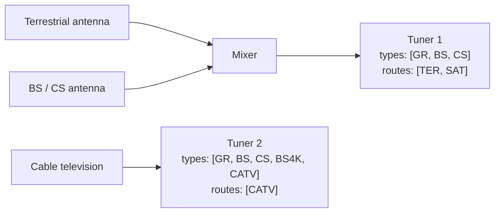
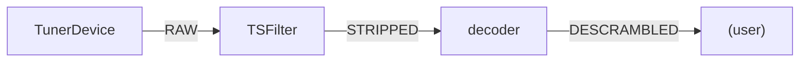
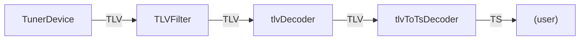
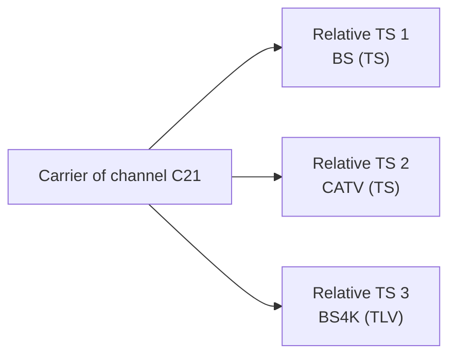
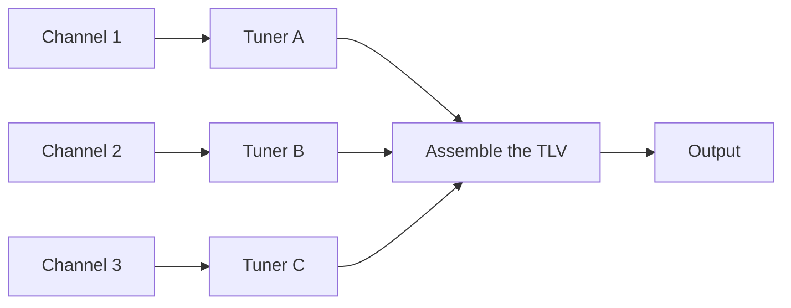
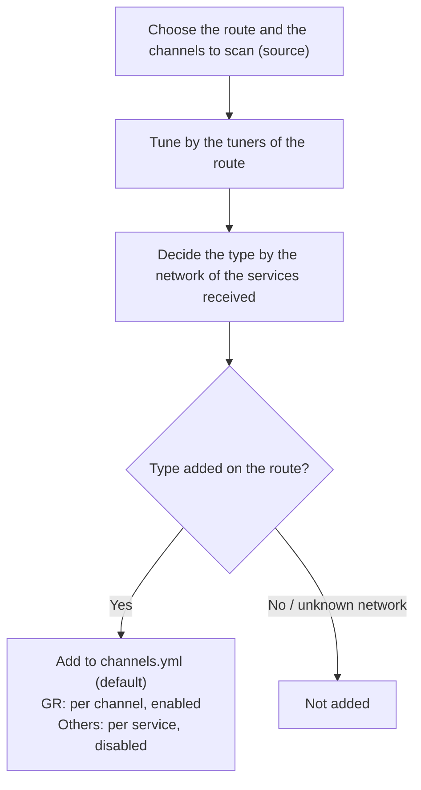

[**English**](Configuration.md) | [**日本語**](Configuration.ja.md)

# Configuration

- 🗒️[server.yml](#serveryml) - Server Settings
- 🗒️[tuners.yml](#tunersyml) - Tuner Settings
- 🗒️[channels.yml](#channelsyml) - Channel Settings

## ⚠️Security Considerations (FYI)

- Mirakurun is designed to be a LAN-only server.
- By default, access is restricted to private IP addresses.
- Access from arbitrary hostnames or domains is prohibited → **DNS Rebinding / CSRF protection**
  - `hostname`: Set the hostname to access the Web UI.
  - `allowOrigins`: Explicitly set allowed hostnames/domains if required.
- Multiple techniques are used to mitigate attack risks.
- Do not allow API access from all domains or deploy without a reverse proxy, as it may be vulnerable to:
  - Attacks reusing authenticated BASIC credentials or session data.
  - Although modern browsers offer protection, do not rely on them entirely.
  - HTTPS reverse proxies might bypass certain browser and Mirakurun safeguards, increasing risk → [Secure Contexts](https://developer.mozilla.org/en-US/docs/Web/Security/Secure_Contexts)
  - Instead, use VPN, SSH tunnels, or tunnel services.
    - Note: Some tunnel services require configuring `allowIPv4CidrRanges` to prevent third-party access.

> **DNS Rebinding Attack**: An attacker controls a domain and initially serves a legitimate site. After the DNS TTL expires, they switch it to point to their malicious server. This bypasses the browser’s same-origin policy and enables unauthorized access to a LAN server via the browser.

> **XSS/CSRF Attack**: An attacker embeds malicious code into a website to gain unauthorized access to a LAN server via the browser.

- Examples of attacks:
  - Execute arbitrary code via tuner commands
  - Inject malicious code into the server and turn it into a botnet
- The above are only a few examples; many others, exploiting browser or middleware vulnerabilities, are devised daily.
- With more web-based applications emerging, they can be as vulnerable to similar attacks as browsers. Exercise caution.

## 🗒️server.yml

📛 Partially supported in Web UI

### File Paths

- Environment Variable: `SERVER_CONFIG_PATH`
- Docker Host (Default): `/opt/mirakurun/config/server.yml`
- Linux (Legacy): `/usr/local/etc/mirakurun/server.yml`

### Server Settings List

| Property (🗒️server.yml) | Environment Variable (🐋Docker) | Type | Default | Description |
|------------|------------------|-------|-----------|------|
| `logLevel` | `LOG_LEVEL` | Integer | `2` | Log Level (`-1`: FATAL to `3`: DEBUG) |
| `maxLogHistory` | `MAX_LOG_HISTORY` | Integer | `1000` | Maximum number of log lines to retain |
| `path` | - | String, null | 🗒️`/var/run/mirakurun.sock` | Unix Socket Path **※Fixed to default in Docker** |
| `port` | - | Integer, null | `40772` | Server Port **※Fixed at `40772` on the container side in Docker** |
| `hostname` | `HOSTNAME` | String | `localhost` | Hostname |
| `disableIPv6` | - | Boolean | `false` | Disable IPv6 **※Always disabled in Docker** |
| `jobMaxRunning` | `JOB_MAX_RUNNING` | Integer | logical cores / 2, min 1, max 100 | Maximum number of jobs that can run simultaneously |
| `jobMaxStandby` | `JOB_MAX_STANDBY` | Integer | logical cores - 1, min 1, max 100 | Maximum number of jobs that can be prepared simultaneously |
| `maxBufferBytesBeforeReady` | `MAX_BUFFER_BYTES_BEFORE_READY` | Integer | `8388608` | Maximum buffer size before ready (bytes)<br>**※Increase if the beginning of the program is missing** |
| `eventEndTimeout` | `EVENT_END_TIMEOUT` | Integer | `1000` | Event end timeout (milliseconds)<br>**※Increase if program end is incorrectly detected** |
| `programGCJobSchedule` | `PROGRAM_GC_JOB_SCHEDULE` | String | `45 * * * *` | Program list GC schedule (cron-like format) |
| `epgGatheringJobSchedule` | `EPG_GATHERING_JOB_SCHEDULE` | String | `20,50 * * * *` | EPG gathering schedule (cron-like format) |
| `epgRetrievalTime` | `EPG_RETRIEVAL_TIME` | Integer | `600000` | EPG retrieval time (milliseconds) |
| `logoDataInterval` | `LOGO_DATA_INTERVAL` | Integer | `604800000` | Logo data update interval (milliseconds) |
| `disableEITParsing` | `DISABLE_EIT_PARSING` | Boolean | `false` | ⚠️Disable EIT parsing |
| `disableWebUI` | `DISABLE_WEB_UI` | Boolean | `false` | ⚠️Disable Web UI |
| `allowIPv4CidrRanges` | `ALLOW_IPV4_CIDR_RANGES` | String[] | `["10.0.0.0/8", "127.0.0.0/8", "172.16.0.0/12", "192.168.0.0/16"]` | ⚠️Allowed IPv4 CIDR blocks |
| `allowIPv6CidrRanges` | `ALLOW_IPV6_CIDR_RANGES` | String[] | `["fc00::/7"]` | ⚠️Allowed IPv6 CIDR blocks |
| `allowOrigins` | `ALLOW_ORIGINS` | String[] | `["https://mirakurun-secure-contexts-api.pages.dev"]` | ⚠️🧪Allowed origins (experimental) |
| `allowPNA` | `ALLOW_PNA` | Boolean | `true` | 🧪[PNA](https://github.com/WICG/private-network-access)/[LNA](https://github.com/explainers-by-googlers/local-network-access) permission settings (experimental) |
| `tsplayEndpoint` | `TSPLAY_ENDPOINT` | String | `https://mirakurun-secure-contexts-api.pages.dev/tsplay/` | 🧪TSPlay endpoint (experimental) |
| `defaultTlvStreamFormat` | `DEFAULT_TLV_STREAM_FORMAT` | String | `tlv` | Output format of the TLV (MMT) channels for the stream requests without `format` (`ts` or `tlv`)<br>If `ts` is selected and no tuner for the channel has `tlvToTsDecoder` configured, HTTP 406 is returned |

Web UIからコピーする外部再生URLとM3U、旧TSPlay向けの再生URLはMPEG-TSを要求します。TLV入力を使う場合は `tlvToTsDecoder` が必要です。これらの出力は `defaultTlvStreamFormat` では変更されません。TLVをそのまま扱う外部クライアントでは、API Docsを参照してTLVのストリームを取得してください。

## 🗒️tuners.yml

💯 Fully supported in Web UI

### File Path

- Environment Variable: `TUNERS_CONFIG_PATH`
- Docker Host (Default): `/opt/mirakurun/config/tuners.yml`
- Linux (Legacy): `/usr/local/etc/mirakurun/tuners.yml`

### Structure

```yaml
# Array
- name: TunerIdentificationName # String
  types: # (GR|BS|CS|SKY|BS4K|CATV)[] - types the tuner can receive
    - GR
    - BS
    - CS
  routes: # (TER|SAT|SKY|CATV|FTTH)[] - routes reaching the input of the tuner. All routes if omitted.
    - TER
    - SAT
  # For chardev/dvb
  # "<template>" will be replaced with `commandVars[template]` or "(empty)" *@4.0.0~
  # "<route>" will be replaced with the route of the channel in lowercase (ter|sat|sky|catv|ftth)
  command: cmd <channel> --arg1 --arg2 <exampleArg1> <exampleArg2>... # String
  # For dvb
  dvbDevicePath: /dev/dvb/adapter/dvr/path # String
  disableDvbDirect: false # Boolean
  # For multiplexing with remote Mirakurun
  remoteMirakurunHost: 192.168.x.x # String
  remoteMirakurunPort: 40772 # Integer
  remoteMirakurunDecoder: false # Boolean
  # Optional parameters below
  decoder: cmd # String
  tlvDecoder: cmd # String
  tlvToTsDecoder: cmd # String
  isDisabled: false # Boolean
```

#### types / routes

A channel is tuned by the tuners whose `types` include the type of the channel and whose `routes` include the route of the channel. See [Types and Routes](#types-and-routes) for the types and the routes.

- `routes` are the routes reaching the input of the tuner. If omitted, the tuner is treated as receiving all routes (same as before).
- Specify multiple routes when, for example, the terrestrial and BS / CS antennas are combined into one cable by a mixer.



In this example, the channels of the route `CATV` are tuned only by tuner 2, and the channels of `TER` and `SAT` only by tuner 1.

#### Channel config files of dvbv5-zap

The bundled [dvbconf-for-isdb](https://github.com/Chinachu/dvbconf-for-isdb) has a channel config file for each route, `dvbv5_channels_<route>.conf`. With `<route>` in `-c`, the file of the route of the channel is used for tuning.

```yaml
- name: adapter0
  types:
    - GR
  routes:
    - TER
  command: dvbv5-zap -a 0 -c ./config/dvbconf-for-isdb/conf/dvbv5_channels_<route>.conf -r -P <channel>
  dvbDevicePath: /dev/dvb/adapter0/dvr0
```

| File | Route | Channels | Delivery system |
|---|---|---|---|
| `dvbv5_channels_ter.conf` | `TER` | `1`-`12`, `13`-`62`, `C13`-`C63` | ISDB-T |
| `dvbv5_channels_sat.conf` | `SAT` | `BSxx_y`, `CSx` (including 4K / 8K) | ISDB-S |
| `dvbv5_channels_sky.conf` | `SKY` | `JCSAT3A-TPxx`, `JCSAT4B-TPxx` | DVB-S2 |
| `dvbv5_channels_catv.conf` | `CATV` | `1`-`12`, `C13`-`C63`, `13`-`62` | DVB-C (J.83 Annex C tuned as Annex A) |
| `dvbv5_channels_ftth.conf` | `FTTH` | `13`-`62`, `BSxx_y`, `CSx`, `73750`-`769250` | ISDB-T, ISDB-S, DVB-C (J.83 Annex B) |

- The channels with a shifted frequency are listed under separate names (such as `4-`-`7-`, `C22-`, `C24+`-`C27+` of `ter` and `catv`). `sat` also has `BS14_0` of the left-hand circular polarization. See the README of dvbconf-for-isdb for details.
- The tuner detection (when tuners.yml does not exist) sets this command, with `routes` of `TER` for the tuners of ISDB-T and `SAT` for the tuners of ISDB-S. For another route, just change `routes` to use the file of that route.
- `dvbv5_channels_catv.conf` is for receiving trans-modulation by the tuners of DVB-C. To receive the pass-through of cable television by the tuners of ISDB-T, specify `dvbv5_channels_ter.conf` instead of `<route>` (`routes` may be left as `CATV`).
- `dvbv5_channels_sky.conf` does not work with stock `dvbv5-zap` (see the README of dvbconf-for-isdb).
- `dvbv5_channels_isdbt.conf` and `dvbv5_channels_isdbs.conf` used until 4.3.0 are kept and work as before.

#### DVB device direct access

For a tuner whose `command` is `dvbv5-zap`, Mirakurun tunes by accessing the DVB device directly instead of running the command. Tuning is faster because Mirakurun does not wait for a process to start and exit. To run the command as before, set `disableDvbDirect: true`.

This applies when the command name at the beginning of `command` (without the directory) is `dvbv5-zap`. So your own wrapper script named `dvbv5-zap`, such as `/opt/bin/dvbv5-zap`, is not run either.

##### Supported options

The following `dvbv5-zap` options are read and used. The long forms (such as `--adapter`) can also be used.

- `-a`, `-f`, `-d`: adapter, frontend and demux numbers (the dvr uses the same number as the demux)
- `-c`: channels file (required)
- `-P`: output all PIDs (required)
- `-I DVBV5`: format of the channels file
- `-l`, `-S`, `-W`, `-U`: satellite LNBf, DiSEqC and SCR/Unicable
- `-w`: LNA

The output options (`-r`, `-o -`) and the display options (`-s`, `-v`, `-N`) are ignored.

For satellite, the LNB power, 22kHz tone, DiSEqC and frequency conversion are handled in the same way as `dvbv5-zap`, and `LNB`, `POLARIZATION` and `SAT_NUMBER` in the channels file are used in the same way. If the LNBf is specified neither by `-l` nor by `LNB` in the channels file, the frequency is not converted and the LNB is not powered.

Supported delivery systems are ISDB-T, ISDB-S and DVB-C (J.83 Annex A / B / C). The command is run for the channels files of DVB-S2 and others.

`<route>` can be used in `-c` (such as `-c ./conf/dvbv5_channels_<route>.conf`). In this case, the channels file of each of `routes` (all routes if omitted) is read, and the file of the route of the channel is used for tuning. For a route whose file can not be read (an unsupported delivery system, a missing file, etc.), the command is run only when tuning the channels of that route.

##### When the command is run

In any of the following cases, the command is run as before instead of accessing the device directly. The reason is logged as a warning at startup.

- An option or value not listed above (such as `-t` or `-I ZAP`) is specified.
- `-c` or `-P` is not specified.
- The arguments other than options are not just `<channel>`.
- A number in the options has a leading zero (`dvbv5-zap` reads it as octal).
- `dvbDevicePath` differs from `/dev/dvb/adapter<a>/dvr<d>` given by `-a` and `-d`.
- The channels file has an unsupported delivery system (such as DVB-S2), unsupported or duplicate properties, or a channel without `FREQUENCY`.
- The channels file has lines that `dvbv5-zap` reads differently (no space before `=`, trailing spaces in a value, CRLF line endings).

If the channels file is edited after startup and can no longer be read, the command is run for each tuning until the file is fixed.

##### Differences from running the command

While tuning directly, the following differ from running the command.

- The tuner's `command` in the API is `/dev/dvb/adapter<n> <channel>` and its `pid` is `null`.
- To speed up the next tuning, the frontend is kept open for 1 second after the tuner is released.
- If tuning fails (e.g. the device cannot be opened or the channel is not found), the stream request fails without retrying.
- If tuning fails 3 times in a row because the device does not exist, the tuner is treated as faulty and is not used until Mirakurun is restarted. A restart is also required after reconnecting a USB tuner.
- Tuning fails for the channels of a delivery system that the frontend does not support. `dvbv5-zap` tunes them with a delivery system of the same kind that the frontend supports instead (such as when the channels file has `DVBC/ANNEX_A` and the frontend supports only `DVBC/ANNEX_C`). Set `disableDvbDirect: true` in this case.

#### decoder

Specify the CAS processing command as needed.

MPEG-2 TS flow (reference):



```sh
# This is an implementation example. For testing only.
sudo npm install arib-b25-stream-test -g --unsafe-perm
```

#### tlvDecoder / tlvToTsDecoder

These are used instead of `decoder` for TLV (MMT) channels of any type. Both can be specified with arguments (quote arguments that contain spaces).

- `tlvDecoder`: CAS processing command that takes TLV and outputs TLV
- `tlvToTsDecoder`: command that takes TLV and outputs MPEG-2 TS

TLV flow (reference):



With `format=tlv`, the stream APIs output TLV without `tlvToTsDecoder`. With `format=ts`, only the tuners with `tlvToTsDecoder` are used to output TS. Without `format`, `defaultTlvStreamFormat` is followed. If a format that cannot be output is requested, 406 is returned.

The clients requesting the streams without `format`, such as EPGStation, record the TLV channels as TLV by default (`tlv`). To record them as TS, set `defaultTlvStreamFormat` to `ts` (the tuners receiving them need `tlvToTsDecoder`).

If `tlvToTsDecoder` keeps failing to start, the stream is closed instead of outputting TLV. If `tlvDecoder` keeps failing to start, the input is passed through as with `decoder`.

## 🗒️channels.yml

💯 Fully supported in Web UI

### File Path

- Environment Variable: `CHANNELS_CONFIG_PATH`
- Docker Host (Default): `/opt/mirakurun/config/channels.yml`
- Linux (Legacy): `/usr/local/etc/mirakurun/channels.yml`

### Structure

```yaml
# Array
- name: ChannelIdentificationName # String
  type: GR # Enum [GR|BS|CS|SKY|BS4K|CATV]
  channel: '0' # String
  # Optional parameters below
  route: TER # Enum [TER|SAT|SKY|CATV|FTTH] - receiving route. Defaults to the default route of the type if omitted.
  serviceId: 1234 # Integer - Services will be automatically scanned if not specified.
  tsmfRelTs: 1 # Number: 1~15 - relative TS of TSMF
  tsmfGroupId: 1 # Number: 1~255 - group of the TLV transmitted over multiple carriers
  format: tlv # Enum [ts|tlv] - format of the data received
  commandVars: # Optional command variables *@4.0.0~
    satellite: EXAMPLE-SAT4A
    space: 0
    freq: 12345
    polarity: H
    exampleArg1: -arg0 -arg1=example
    exampleArg2: -arg2 "Can include spaces using quotes"
  isDisabled: false # Boolean
```

### Types and Routes

- Type (`type`): what the broadcast is. The channel scan decides it by the network of the services received.
- Route (`route`): where it comes from. The same BS is `SAT` from a satellite antenna, and `CATV` from cable television.

| Type | Broadcast | Network used by the scan to decide the type (original_network_id) | Route if `route` is omitted |
| --- | --- | --- | --- |
| `GR` | Digital terrestrial | `0x7880`-`0x7FE8` | `TER` |
| `BS` | BS digital | `4` | `SAT` |
| `CS` | 110 degree CS | `6`, `7` | `SAT` |
| `SKY` | 124 / 128 degree CS (SKY PerfecTV! Premium Service) | `1`, `3`, `10` | `SKY` |
| `BS4K` | TLV (MMT) broadcasts (such as BS 4K / 8K) | TLV (any network) | `SAT` |
| `CATV` | Community channels of cable television, etc. | `0xFFF7`, `0xFFF9`, `0xFFFA`, `0xFFFD`, `0xFFFE`, `0xFFFF` | `CATV` |

| Route | Connected to | Types added by the scan |
| --- | --- | --- |
| `TER` | Terrestrial antenna | `GR` |
| `SAT` | BS / 110 degree CS antenna | `BS`, `CS`, `BS4K` |
| `SKY` | 124 / 128 degree CS antenna | `SKY` |
| `CATV` | Cable television (including transmodulation delivered over optical fiber) | All |
| `FTTH` | Television over optical fiber (terrestrial and BS / CS passed through, SKY PerfecTV! Premium Service Hikari) | All |

- When the same broadcast is received through multiple routes, it can be configured as a separate channel for each route. However, of the entries of the same type and channel, only the first one that is enabled and has a tuner of the type on its route is used. If multiple channels can receive the same stream, the route with an available tuner is tuned (the channel scanned first is preferred).
- A service is associated with the routes by the stream received (`networkId` and `transport_stream_id`). The stream received on each channel is saved in `channels.json` (environment variable: `CHANNELS_DB_PATH`, default: in the same directory as `services.json`).

> [!NOTE]
> `BS4K` and `CATV` have been added to the public `ChannelType` union. TypeScript consumers covering the types with `switch` or `Record<ChannelType, ...>` need to add `BS4K` and `CATV`. `GR`, `BS`, `CS` and `SKY` remain supported.

#### tsmfRelTs

TSMF transmits multiple streams (relative TSs) together over one carrier (such as CATV). `tsmfRelTs` specifies the number of the relative TS to receive. A relative TS of TLV can also be specified.



- If specified, the relative TS is received (see below for the channels received only by the remote tuners).
- If omitted, the service scan (Mirakurun automatically getting the services of the channels configured) on a local tuner detects the relative TSs and their formats (TS / TLV) from the TSMF headers, and saves them in `channels.json`. The services are scanned for each relative TS, and viewing and recording receive the relative TS of the service.
- New services are registered only when the channel has no services, as before (the services of a TLV of multiple carriers and of a TLV detected by the remote Mirakurun are added if no service of the TLV is registered).
- The channel scan adds `tsmfRelTs` if the channel has only one relative TS of the type ([TSMF channels](#tsmf-channels)).
- When the relative TS of a service is unknown, the relative TS with the most slots is received, chosen from those of the network of the service (or from all relative TSs if there are none); ties go to the lower number.
- チャンネル全体や搬送波を取得する場合の指定方法は、Web UI の「API Docs」を参照してください。

<details>
<summary>Receiving by the tuners of a remote Mirakurun</summary>

- The relative TSs detected are received by the local tuners first. The remote tuners receive them by the query `tsmfRelTs` on the stream of the channel of the remote Mirakurun (the remote Mirakurun bonds the TLV of multiple carriers).
- The remote tuners are used to receive a detected relative TS only when all of the following are met:
    - The remote Mirakurun supports the query (checked with the API definition of the remote; 4.3.0 and earlier do not support it. Checked again every 10 seconds if it cannot be checked, and every 10 minutes if not supported)
    - The remote Mirakurun has also detected the relative TS of the channel (`tsmfRelTs` of `services` of `/api/channels/{type}/{channel}`. Omit `tsmfRelTs` in channels.yml of the remote, or set the same value)
    - The remote has not refused the relative TS in the last 10 minutes
- The service scan of a channel received only by the remote tuners receives the relative TSs detected by the remote Mirakurun (`tsmfRelTs` and `format` of `services`).
- If the only available tuners are connected to Mirakurun 4.3.0 or earlier, channel playback without a relative TS uses the remote server’s default output. If a saved reception path specifies a relative TS, service playback and recording require a compatible tuner even when `tsmfRelTs` is omitted from the local channel configuration. If the remote server’s default output carries the service, rescanning can update the reception path.
- The stream as received by the remote tuners is treated as the format the remote Mirakurun outputs (`format` of channels.yml, TS for the channel whose relative TSs are detected by the remote Mirakurun, otherwise the format saved by the service scan or the default of the type).
- リモートの認証・認可や配信対象の不在などで要求を継続できない場合は、その要求の再起動を止めます。認証・認可の失敗は、相対TSの非対応として保持しません。一時的な障害では、従来どおり待機後に再接続します。

</details>

#### format

The format of the data received on the channel (`ts` / `tlv`): of the relative TS of `tsmfRelTs` if specified, otherwise of the stream as received.

- If omitted, it is detected by the service scan on a local tuner for TLV (a tuner with `BS4K` in `types`, or with `tlvDecoder` / `tlvToTsDecoder`), and saved in `channels.json` (to avoid extra processing in TS-only environments. The tuners not for TLV detect only the relative TSs of TSMF and their formats). Before the scan, `tlv` for `BS4K`, `ts` for the others.
- The streams for viewing and recording do not detect it (to avoid delaying the start of TS streams).
- If `tsmfRelTs` is omitted and the relative TSs are detected, each relative TS is received in the format detected.

#### tsmfGroupId

The group of a TLV transmitted over multiple carriers (channel bonding of CATV). The channels of the same `type`, route and `tsmfGroupId` are tuned at the same time by separate tuners, and the TLV is assembled. Any channel of the group outputs the same TLV.



```yaml
- name: TLV (1)
  type: BS4K
  route: CATV
  channel: '1'
  tsmfRelTs: 1
  tsmfGroupId: 8
- name: TLV (2)
  type: BS4K
  route: CATV
  channel: '2'
  tsmfRelTs: 1
  tsmfGroupId: 8
- name: TLV (3)
  type: BS4K
  route: CATV
  channel: '3'
  tsmfRelTs: 1
  tsmfGroupId: 8
```

- As many tuners that can tune the channels as there are carriers are required (local tuners if `tsmfRelTs` and `tsmfGroupId` are omitted. With only remote tuners, the remote Mirakurun bonds the carriers). The tuners of the carriers are shown in `/api/tuners` as the users `<user ID>#carrier<n>`.
- A tuner receiving the same carrier is shared with EPG gathering and the other streams. Joining a shared reception does not end the existing use even with a higher priority. If another carrier is needed and no tuner is available, the tuners are switched by priority as before.
- If `tsmfRelTs` and `tsmfGroupId` are omitted, the service scan gets the relative TS, stream ID, group ID and number of carriers from the headers, and saves them in `channels.json`. When the channels of all the carriers transmitting the same TLV of the same type, route and group are enabled in channels.yml (they can be added by the [channel scan](#tsmf-channels). They are added disabled by default, so enable all of them), the services of the TLV are scanned using additional tuners. The services of TS on the same carrier are scanned even before that. If fewer local tuners are configured than there are carriers, getting the services of the TLV is put on hold.
- The TLV assembled is output after it is confirmed to be continuous (up to about 0.5 seconds of difference in delay between the carriers). It usually takes less than 1 second, but can take about 10 seconds with 4 or more carriers.
- The stream ends when any carrier cannot be received for about 10 seconds (including starting the tuner), or the TLV cannot be assembled for a while.

### Channel Scan

"Channel Scan" of the Web UI (`PUT /api/config/channels/scan`) scans the channels of a route and adds them to channels.yml. The channels of CATV mixing terrestrial, BS, CS, BS4K and community channels can also be added in a single scan. It is different from the "service scan", which automatically gets the services of the channels configured.



How the type is decided and which types are added on each route are shown in the tables of [Types and Routes](#types-and-routes) (for example, `SKY` received by a scan of the route `SAT` is not added). Whether entries are added per channel or per service, and whether they are added enabled, can be changed with "Scan Mode" and "Set Disabled on Add" of the Web UI (`scanMode` and `setDisabledOnAdd` of the API).

#### Channels to scan (`source`)

- `preset`: the default channels of the route (the channel names of recpt1, recisdb, etc.)
    - TER: `13`-`62`
    - SAT: `BS01_0`-`BS23_3`, `CS2`-`CS24`
    - SKY: none (specify by `dvbConf` or `list`)
    - CATV: `1`-`12` (VHF), `C13`-`C63`, `13`-`62`
    - FTTH: `13`-`62`, `BS01_0`-`BS23_3`, `CS2`-`CS24` (specify SKY of SKY PerfecTV! Premium Service Hikari by `dvbConf` or `list`)
- `dvbConf`: all the channels of the channel config files of dvbv5-zap (`-c`) of the tuners used for the scan (including channel config files that DVB direct access cannot handle, such as DVB-S2)
- `list`: the channels specified (`channels`)
- `format`: the format of the channel names (`channelNameFormat`, e.g. `C{ch}`) and the range

The default is `preset`. The Web UI selects `dvbConf` when the route is `SAT` or `SKY` and all the tuners used for the scan are of dvbv5-zap, because the tuners of dvbv5-zap can not tune the channels not in the channel config file, and fewer channels are scanned than by `preset`.

#### Tuners used

- The tuners of the route (with the route in `routes` or without `routes`, and with a type added on the route in `types`) are used.
- If there are tuners of different kinds (such as ISDB-T and ISDB-S), each channel is tried by them until received (tuners with the same `types` are tried only once).
- For a tuner receiving multiple types, specify all the types to receive in `types`. If no tuner on the route can tune the type of an added channel, the scan log reports it.
- The tuners of a remote Mirakurun are tried by each type, because they receive only the channels of the types configured on the remote.

#### BS channels not broadcast

The scans of `preset` and `dvbConf` on the routes `SAT` and `FTTH` skip the BS channels not broadcast in TS, by the NIT of the first BS channel received (the TSID and the frequency of all the TS of BS), to save the wait for each channel not received. The skipped channels are shown in the scan log.

- Tuners using a channel config file of dvbv5-zap: a channel is skipped if its `FREQUENCY` is of a BS transponder (right-hand circular polarization) and its `STREAM_ID` (TSID) is not in the TS of the transponder in the NIT. If `STREAM_ID` is not a TSID (the relative TS number 0-7, or omitted), the channel is handled by the transponder, as by the name below.
- Tuners of the other commands: xx of the channel name `BSxx_y` is the transponder number. After all the TS of the transponder in the NIT are received by the channels of the transponder in the scan, the rest of the channels (such as `BS01_3`) are skipped. The channels are not skipped by the number of the TS, because the numbers of `_y` may have gaps (such as `BS09_0` and `BS09_2`).
- The channels of the transponders not in the NIT are skipped on the tuners not for TLV. The transponders not in the NIT are those of TLV for 4K, and the even numbers (the left-hand circular polarization) handled by the name. TLV is not detected on the skipped channels, so they are not added as 4K channels either. Specify `BS4K` in `types` of the tuners receiving 4K.
- The channels of the frequencies of the left-hand circular polarization in a channel config file of dvbv5-zap are not skipped, because they are not handled as BS transponders (right-hand circular polarization).
- The TS of the channels taken over with "Refresh" (`refresh`) off are not received, so the rest of the channels of the transponder are scanned on the tuners handled by the name.
- The channels specified by `list` and `format` are not skipped, nor are any channels if the NIT is not received (such as not completed within 20 seconds on the first BS channel received).

#### TSMF channels

- The channel scan detects the relative TSs of TSMF even on the tuners not for TLV.
- If the channel has only one relative TS of the type, `tsmfRelTs` is added (any tuner can receive it). If two or more, it is not added and left to the detection by the service scan (also on the tuners not for TLV).
- The remote tuners scan the relative TSs detected by the remote Mirakurun, and `tsmfRelTs` is not added (the remote Mirakurun outputs the relative TS).
- Even when scanned by the local tuners, `tsmfRelTs` is not added for a type received only by the remote tuners if every remote Mirakurun outputs the relative TS of the channel (detected, or `tsmfRelTs` in channels.yml of the remote; a remote of 4.3.0 or before also counts).
- Relative TSs whose services could not be received are still counted toward the relative TSs of the type, based on the network in the header (so `tsmfRelTs` may not be added; this is logged). Their services are added by scanning the channel again with "Refresh" (`refresh`) on. However, some relative TSs have no services (SDT) in the first place, such as for the engineering, and they are never added.
- The carriers of a TLV transmitted over multiple carriers (such as BS8K) are added as `BS4K` channels even without services (disabled by default. `tsmfRelTs` and `tsmfGroupId` are not written, and are detected by the service scan).

#### Rewriting channels.yml

- The entries of the route (of any type) of the channels scanned are replaced with the result (the entries of the channels not received are deleted). The entries of the channels not scanned and of the other routes remain.
- With "Refresh" of the Web UI (`refresh` of the API) off, the channels with an enabled entry on the route are not scanned, and the entries remain.
- Channels are identified by the combination of type and channel. If an enabled entry of the same type and channel is on another route with a tuner of the type, that entry remains and the channel scanned is not added.
- With "Auto Apply Results" of the Web UI off (default), the result is shown without rewriting channels.yml. 「スキャン結果を適用」 (apply the scan results) applies it to the settings being edited. With the API, channels.yml is not rewritten if `dryRun` is specified.

#### Compatibility with 4.3.0 or before (deprecated)

`type` (`GR`, `BS` or `CS`) can also be specified instead of `route` and `source`. The same channels as in 4.3.0 are scanned by the tuners of the type, treating it as the default route of the type (GR: TER, BS and CS: SAT).

- GR: `13`-`62`
- BS: `BS01_0`-`BS23_3` (`useSubCh`, default) or `101`-`256`
- CS: `CS2`-`CS24`

The range is changed by `minCh`, `maxCh`, `minSubCh`, `maxSubCh` and `channelNameFormat`. `skipCh` also matches the numbers in the channel names. Only the entries of the type are replaced, and the entries of the other types remain.
